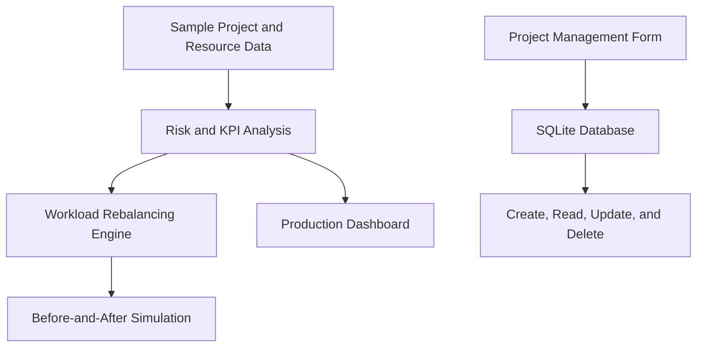

# Production Control Tower

## Project Delivery & Resource Optimization

**A portfolio preview of a production management web application built with Python and Streamlit.**

The Production Control Tower converts project progress and employee-capacity data into operational KPIs, delivery-risk alerts, and practical workload-rebalancing recommendations. It also includes a persistent project-management workspace backed by SQLite.

**Built by Enzo · Portfolio Demonstration · Synthetic Data Only**  
**Project Date: 2026 · Version: 1.0**

---

## Business Problem

Production teams often manage project status and employee workload in separate spreadsheets or disconnected tools. This makes it difficult to identify delivery risks, detect overloaded employees, and rebalance work before deadlines are affected.

This application provides one management view for answering four operational questions:

- Which projects are completed, on track, at risk, or delayed?
- Which employees are above their available capacity?
- How much excess workload must be reassigned?
- How can available capacity be used to rebalance the team?

---

## Delivered Capabilities

- Executive KPIs for project completion, team utilization, and excess workload
- Production-risk alerts for overloaded employees and projects requiring attention
- Employee-level capacity and utilization analysis
- Automated workload-rebalancing recommendations
- Before-and-after workload simulation with an interactive Plotly chart
- Project creation, editing, and deletion through Streamlit forms
- Persistent project records stored in a local SQLite database
- Input validation for project progress and safe parameterized database operations

---

## Validated Demonstration Results

The embedded synthetic scenario contains five projects and five employees.

| Management Metric | Demonstration Result |
|---|---:|
| Project Completion Rate | 20.0% |
| Team Utilization | 99.0% |
| Excess Workload | 23 hours |
| Overloaded Employees | 3 |
| Projects At Risk or Delayed | 2 |
| Workload Reassigned by the Simulation | 23 hours |

The rebalancing simulation transfers all identified excess hours into available team capacity, leaving every employee at or below the 40-hour planning threshold.

---

## Application Workflow



---

## Core Planning Logic

| Measure | Calculation |
|---|---|
| Employee Utilization | Assigned Hours ÷ Available Hours × 100 |
| Excess Workload | Maximum of 0 or Assigned Hours − Available Hours |
| Project Completion Rate | Completed Projects ÷ Total Projects × 100 |
| Rebalancing Recommendation | Transfer excess hours to employees with remaining capacity |

The current rebalancing engine prioritizes capacity availability. It is designed as a transparent portfolio demonstration rather than a complete workforce-optimization model.

---

## Quick Start

### 1. Clone the Repository

```powershell
git clone https://github.com/enzosafadi/production-control-tower.git
cd production-control-tower
```

### 2. Create a Virtual Environment

```powershell
py -m venv .venv
```

### 3. Install the Dependencies

```powershell
.\.venv\Scripts\python.exe -m pip install -r requirements.txt
```

### 4. Run the Application

```powershell
.\.venv\Scripts\python.exe -m streamlit run app.py
```

Streamlit will display the local application address in the terminal.

---

## Technology Stack

| Component | Purpose |
|---|---|
| Python | Application and analytical logic |
| Streamlit | Interactive web-application interface |
| Pandas | Data preparation and KPI calculations |
| Plotly | Interactive workload visualization |
| SQLite | Persistent local project storage |

---

## Project Structure

```text
production-control-tower/
├── app.py
├── database.py
├── requirements.txt
└── README.md
```

- `app.py` contains the dashboard, risk logic, rebalancing simulation, and project-management interface.
- `database.py` manages the SQLite project table and its create, read, update, and delete operations.
- `requirements.txt` defines the required Python packages.

---

## Controls & Limitations

- All dashboard and workforce data are synthetic and embedded for demonstration.
- SQLite is configured for local, single-user portfolio use.
- The application does not currently include authentication or role-based access.
- Rebalancing considers available hours, but not employee skills, project dependencies, budgets, or due dates.
- Recommendations should be validated by an operations manager before use in a production environment.

---

## Production Roadmap

1. Connect the dashboard to project-management, ERP, or workforce-planning systems.
2. Add project deadlines, milestones, dependencies, budgets, and schedule variance.
3. Match workload by employee skills, roles, availability, and project priority.
4. Introduce authentication, role-based permissions, and a multi-user database.
5. Add historical trends, automated alerts, exports, and an operational audit trail.

---

## Portfolio Context

This repository demonstrates how production-management data can be transformed into a clear, decision-oriented web application. It is a preview of a broader Production Control Tower concept and is intended for portfolio evaluation rather than live operational deployment.

---

Copyright © 2026 Enzo. Released as a portfolio demonstration.

## Who it benefits

Production managers, project coordinators and resource planners: delivery-risk visibility and capacity-based workload-rebalancing scenarios.

These are intended users and benefits, not evidence of adoption or measured customer outcomes.
